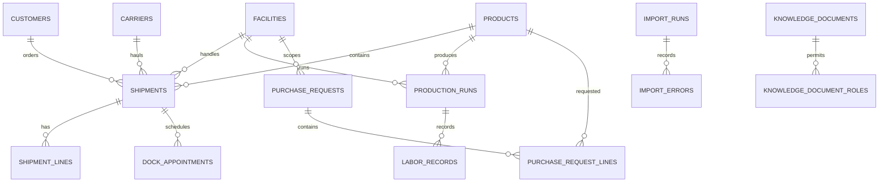

# Data dictionary

| Table/view | Purpose | Key fields |
| --- | --- | --- |
| facilities | Growing/packing locations | facility_id, facility_code |
| customers | Buyers | customer_id, customer_name |
| products | Produce and UOM | product_id, sku, uom |
| shipments | Operational loads | shipment_id, status, ordered_qty, shipped_qty, UTC timestamps, row_version |
| shipment_lines | Product quantities | shipment_line_id, shipment_id |
| dock_appointments | Dock schedule | appointment_id, shipment_id, dock_code |
| production_runs | Production output runs | production_run_id, run_date, output_qty |
| labor_records | Labor captured against production runs | labor_record_id, production_run_id, work_date, labor_group, labor_hours |
| purchase_requests/lines | Approval workflow | request_id, status, version_no, quantity, unit_cost |
| audit_events | Immutable business history | actor, action_name, entity_id, detail_json |
| import_runs/errors | Ingestion trace | status, applied_count, rejected_count |
| knowledge_documents/roles | Search corpus and access | sensitivity, role_name |

Key constraints enforce positive quantities, shipped <= ordered, valid workflow statuses, foreign-key integrity, and decimal precision.

Migration 008 makes `labor_records` the dashboard labor source. The original `production_runs.labor_hours` column remains for backward-compatible history and is copied into one deterministic `Packing crew` record per seeded run.

## Relationship diagram

